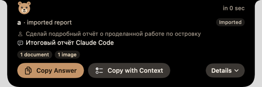
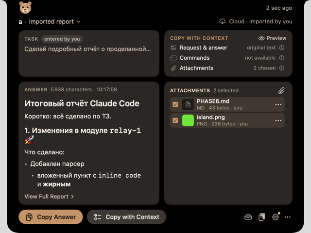
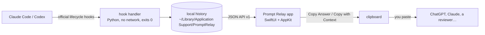

# Prompt Relay

**The final answer of your AI coding agent, verbatim, one click from any other chat.**

Prompt Relay is a small macOS app that lives at the MacBook notch. When Claude
Code or Codex finishes a task, it keeps the agent's complete final answer —
exactly as written — together with the request, the project and the files the
agent verifiably wrote. **Copy Answer** puts the text on your clipboard.
**Copy with Context** hands a reviewer (another AI or a person) everything
needed to check the work, every claim labelled *Reported by the agent* or
*Confirmed locally*.

<p align="center">
  
  &nbsp;
  
  <br><sub>Quick Peek and Details, rendered offscreen by the test suite from synthetic data.</sub>
</p>

## Why

Planning in one AI and building with another means copying long answers by
hand: Markdown breaks, conversations get mixed up, and "all tests pass" is
taken on faith. Prompt Relay copies the exact text and separates what the
agent *claimed* from what was *observed on your Mac*.

## How it works



1. A small plugin/hook receives the agent's events (prompt, stop, tool use).
2. The Python Core stores each turn locally, verbatim, one conversation at a time.
3. The app watches that history and shows it in an island at the notch: hover to peek, click for details.
4. You copy the answer, or a context pack, and paste it where you want.

## Features

- **Verbatim capture** through official hooks. No scraping, no AI API calls, no tokens spent.
- **All your projects**: capture follows the agent into any folder; exclude a project or pause at any time.
- **Copy with Context**: request, answer, project, agent, host, completion state, commands and files observed. A secret check runs before anything is copied.
- **Background-work aware**: an answer is not "ready" while tests it started are still running; "needs your input" is shown when the agent is waiting for you.
- **Attachments**: result files the agent wrote and named are attached automatically; an optional screenshot of the window where the agent worked is kept in memory only.
- **Inbox and History** across projects and agents, search, follow-latest or stay on one conversation.
- **First-run Setup** that says *Connected* only after a real event arrived.
- Works on the MacBook notch (and stays there with an external monitor); a small floating island on displays without a notch.

## Privacy and security

Everything stays on your Mac: no network access, no account, no telemetry, no
AI service. Data lives in `~/Library/Application Support/PromptRelay` (folder
0700, files 0600), never inside the app or the plugin. The hook handler never
writes to stdout, always exits 0, does no network I/O and never reads
transcripts or project files. Window screenshots are held in memory and are
never written to disk unless you export them. Nothing leaves the Mac unless
you paste it. Full threat model: [docs/SECURITY.md](docs/SECURITY.md).

## Install (macOS 14+)

1. Download **Prompt Relay.zip** from the [latest release](https://github.com/Banderos14/prompt-relay/releases), unzip and move the app to `~/Applications`.
2. The build is signed with a development certificate but **not notarized**, so macOS warns on the first launch: right-click the app → **Open** → **Open**.
3. Open Prompt Relay → **Set Up**. It shows the exact commands to connect Claude Code (and Codex) and how to undo them.
4. Connect Claude Code manually if you prefer:
   ```bash
   claude plugin marketplace add Banderos14/prompt-relay
   claude plugin install prompt-relay@prompt-relay
   ```
5. Send any prompt in Claude Code. The answer appears at the notch.

Requirements: macOS 14 or newer, Python 3.9+ (Xcode Command Line Tools, Homebrew or python.org — the app tells you if none is found), Claude Code and/or Codex. Optional screenshots need **Screen Recording** permission, which the app asks for only when you turn them on.

## Limitations

- Pre-release (0.9): not notarized; no auto-update.
- Mixed text and images in one paste are not supported by most chat apps; images are handed over in a second step by design.
- A window screenshot shows whatever the window displays at that moment, not a specific tab inside it.

## License

Source-available, **all rights reserved** — see [LICENSE](LICENSE). You may
read the code and use the released app personally; copying, modifying and
redistributing are not allowed. No external contributions are accepted.

## For reviewers

| | |
|---|---|
| Stack | Python 3.9+ (stdlib only) Core · Swift / SwiftUI + AppKit · ScreenCaptureKit · FSEvents |
| Tests | `scripts/check.sh` (Python Core), `(cd macos && swift test)` (app, offscreen) |
| Architecture | [docs/ARCHITECTURE.md](docs/ARCHITECTURE.md) · [decisions (ADRs)](docs/DECISIONS.md) |
| Case study | [docs/PORTFOLIO.md](docs/PORTFOLIO.md) |
| Docs index | [docs/](docs) (phase-by-phase history in [docs/archive](docs/archive)) |
