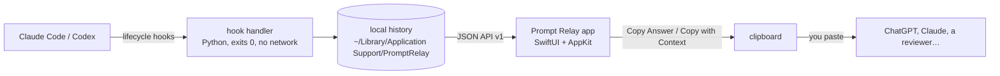

# Prompt Relay

**The final answer of your AI coding agent, verbatim, one click from any other chat.**

Prompt Relay is a small macOS app at the notch. When Claude Code or Codex
finishes a task in a project you enabled, it keeps the agent's complete
final answer — exactly as written — with the request, the project, the
agent and host, and the files the agent verifiably wrote. **Copy Answer**
gives you the text; **Copy with Context** gives a reviewer (another AI or a
person) everything needed to check it, labelled *Reported by the agent* or
*Confirmed locally*.

<p align="center">
  
  <br><sub>The island's Details view, rendered offscreen by the test suite from synthetic data.</sub>
</p>



## Features

- **Verbatim capture** of every final answer through official hooks (Claude
  Code plugin; Codex hook profiles for Terminal and Xcode). No scraping, no
  AI API calls, no tokens spent.
- **Copy with Context**: request + answer + project, agent, host, completion
  state, commands and files observed, with provenance labels. Secret check
  before copying.
- **Background-work aware**: an answer is not "ready" while tests it started
  are still running.
- **Attachments**: result files the agent wrote and named are pre-selected;
  window snapshots (opt-in, system picker) stay in memory only.
- **History** per project and conversation, search, follow-latest or stay
  on a conversation.
- **First-run Setup** that says *Connected* only after a real event arrived.

## Privacy

Everything stays on your Mac. No network access, no account, no telemetry,
no AI service. Capture is off until you enable a project. History lives in
`~/Library/Application Support/PromptRelay` (folder 0700, files 0600) and is
never inside the app or the plugin. Window snapshots are never written to
disk unless you export them. Nothing leaves the Mac unless you paste it.
Details: [SECURITY](docs/SECURITY.md).

## Requirements

macOS 14 or newer · Python 3.9+ (Command Line Tools, Homebrew or python.org;
the app tells you if none is found) · Claude Code and/or Codex.

## Install

- **Release download** — not published yet. Signed and notarized builds
  will be on GitHub Releases ([RELEASE](docs/RELEASE.md)).
- **From a checkout** (developers): `scripts/install-local.sh --dry-run`,
  then `scripts/install-local.sh`. It builds, verifies, keeps your previous
  app as a backup and never touches your history or agent settings
  ([INSTALL](docs/INSTALL.md)).

Then open Prompt Relay → **Set Up**: connect an agent (it shows the exact
commands and how to undo them), enable a project, send any prompt.

Connect Claude Code by hand:
```bash
claude plugin marketplace add Banderos14/prompt-relay   # or the path of your checkout
claude plugin install prompt-relay@prompt-relay
```
Codex: `macos/Integrations/configure-codex.py` (preview first; see [PHASE9](macos/PHASE9.md)).

## Limitations

- Pre-release; no signed build is published yet.
- Codex setup currently needs a source checkout (the hook command points to
  its launcher).
- Mixed text + image in one paste is not supported by most chat apps; Copy
  with Context hands over images in a second step, by design.
- Some checks need a person at a Mac (real paste into web chats, the window
  picker); see `macos/PHASE11.md`.

## Contributing · License

See [CONTRIBUTING](CONTRIBUTING.md). **License: not chosen yet** — until the
owner adds a LICENSE file, all rights are reserved. Relay the bear and other
graphics are original to this project and follow the same license.

## Tests
```bash
scripts/check.sh                 # Python Core (also with python3.9 if present)
(cd macos && swift test)         # Swift app model and views (offscreen)
scripts/synthetic_demo.sh        # isolated demo with a MOCK clipboard
```

## CLI
```bash
bin/prompt-relay enable ~/code/my-project     # opt in a project
bin/prompt-relay sessions                     # captured sessions
bin/prompt-relay turns [--session ID]         # turns with status and link quality
bin/prompt-relay show [--project DIR]         # print the latest final answer verbatim
bin/prompt-relay copy [--verify]              # Copy Response → clipboard (macOS)
bin/prompt-relay context                      # preview Copy Context
bin/prompt-relay copy-context                 # Copy Context → clipboard (secret check first)
bin/prompt-relay sessions --json              # machine API for the app (docs/JSON_API.md)
bin/prompt-relay prune --older-than-days 30   # preview deletion of old sessions; add --yes to delete
bin/prompt-relay delete --session ID          # preview; add --yes (and --force-active for a live session)
bin/prompt-relay doctor [--json]               # Python, storage, capture, plugin/settings registration (read-only)
bin/prompt-relay pin-python [--show]           # the Python the plugin hook uses (enable pins one automatically)
bin/prompt-relay hook-config                  # settings-hook JSON for isolated checks (`claude --settings`); writes nothing
```

## Documentation
| Doc | Content |
|---|---|
| [PRODUCT_SPEC](docs/PRODUCT_SPEC.md) | vision, users, stories, scope, non-goals |
| [ARCHITECTURE](docs/ARCHITECTURE.md) | components, data flow, hook contract, correlation |
| [DATA_MODEL](docs/DATA_MODEL.md) | on-disk format (contract for the future app) |
| [PLUGIN](docs/PLUGIN.md) | install, enable, disable, uninstall, diagnostics, coexistence |
| [DECISIONS](docs/DECISIONS.md) | ADR-001…022 |
| [JSON_API](docs/JSON_API.md) | machine-readable CLI API v1, versioning rules ([schema](docs/api/api-v1.schema.json)) |
| [HOOKS_RESEARCH](docs/HOOKS_RESEARCH.md) | hook schemas, install options, open questions |
| [SECURITY](docs/SECURITY.md) | threat model, privacy, installation safety |
| [TEST_PLAN](docs/TEST_PLAN.md) | unit, integration, manual and regression tests |
| [ROADMAP](docs/ROADMAP.md) | phases and acceptance criteria |
| [UI_RESEARCH](docs/UI_RESEARCH.md) | notch UI foundations, OpenNook vs custom panel, Coucou reference |
| [MACOS_APP](docs/MACOS_APP.md) | the macOS app and notch island: build, Xcode, architecture, verification |
| [LOCAL_MAC_VALIDATION](docs/LOCAL_MAC_VALIDATION.md) | step-by-step Mac checks |
| [CLOUD_TO_LOCAL_HANDOFF](docs/CLOUD_TO_LOCAL_HANDOFF.md) | how to continue in a local session |
| [INSTALL](docs/INSTALL.md) | install, local developer install, troubleshooting |
| [RELEASE](docs/RELEASE.md) | signing, notarization, GitHub Release checklist |
| [MCP_EVALUATION](docs/MCP_EVALUATION.md) | hooks vs MCP, read-only MCP design (not built) |
| [MULTI_AGENT_MODEL](docs/MULTI_AGENT_MODEL.md) | provider → profile → host identity proposal |
| [STATUS](docs/STATUS.md) | current state, verification matrix, risks |
| [SELF_REVIEW](docs/SELF_REVIEW.md) | Core audit results and the Phase 1.5 plan |
