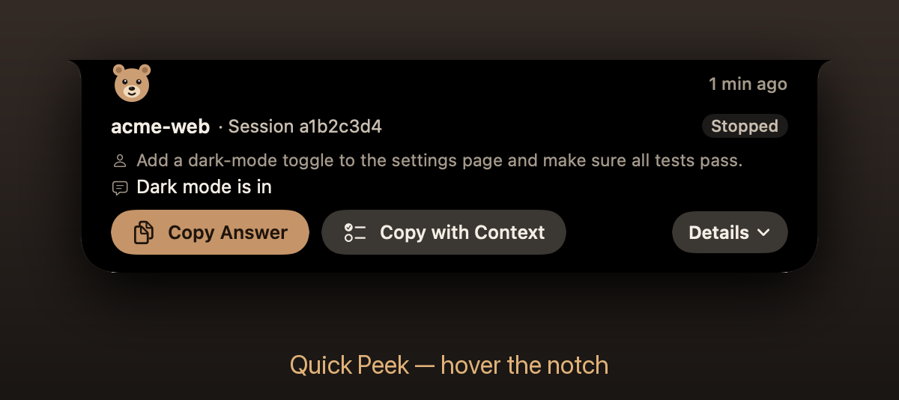
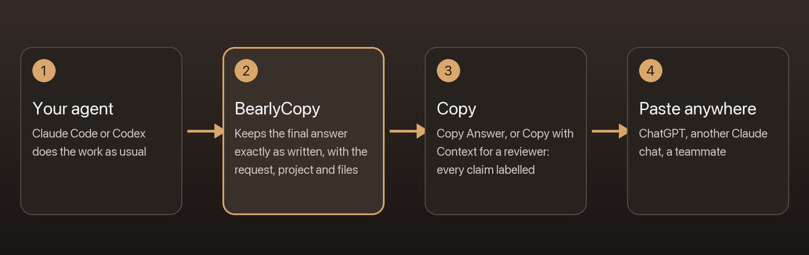
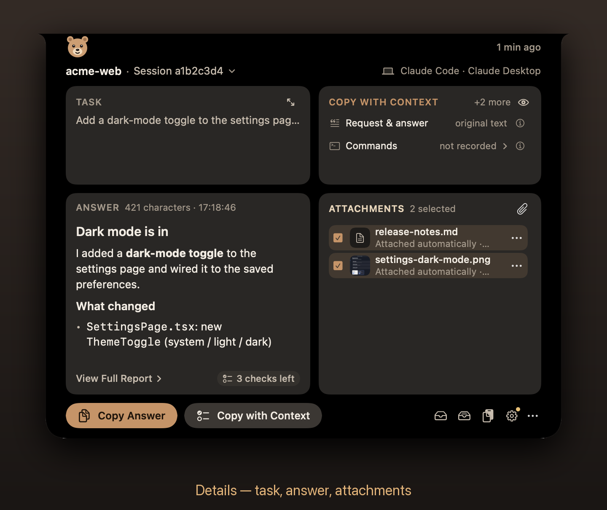
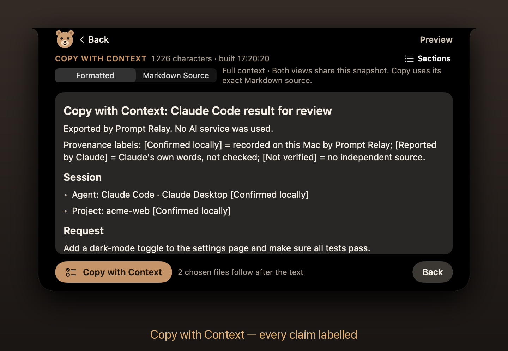
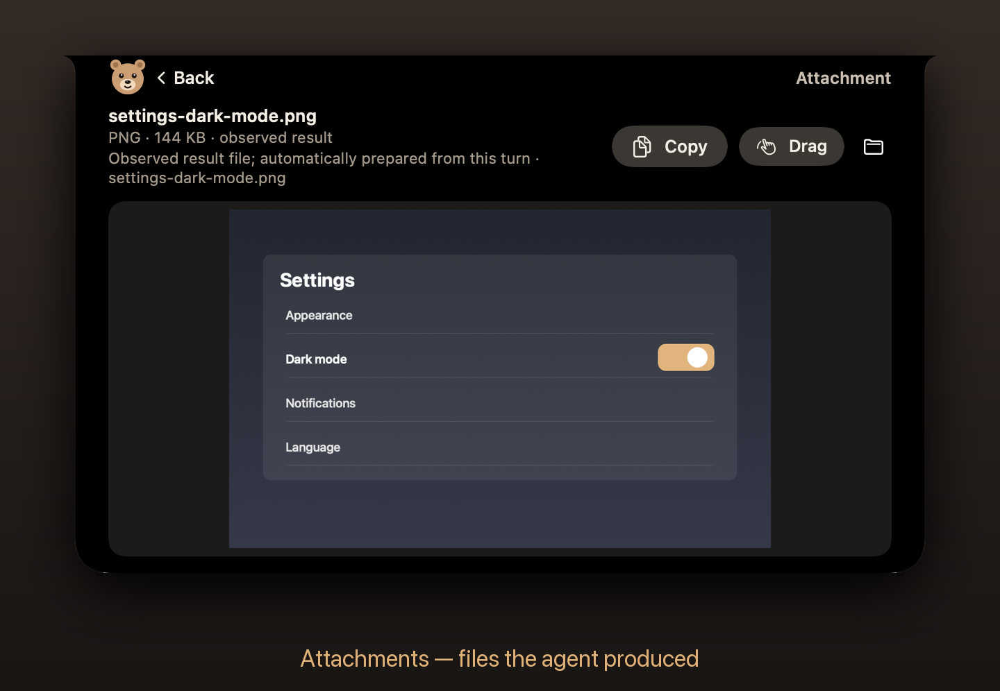
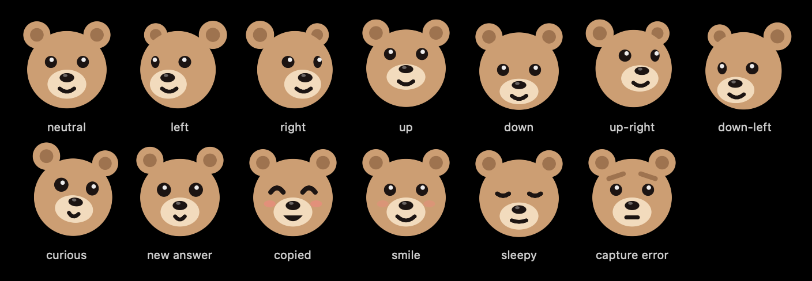

# Prompt Relay

**The final answer of your AI coding agent, verbatim, one click from any other chat.**

Prompt Relay is a small macOS app that lives at the MacBook notch. When Claude
Code or Codex finishes a task, it keeps the agent's complete final answer —
exactly as written — together with the request, the project and the files the
agent verifiably wrote. **Copy Answer** puts the text on your clipboard.
**Copy with Context** hands a reviewer (another AI or a person) everything
needed to check the work, every claim labelled *Reported by the agent* or
*Confirmed locally*.

<p align="center">
  
</p>

## Why

Planning in one AI and building with another means copying long answers by
hand: Markdown breaks, conversations get mixed up, and "all tests pass" is
taken on faith. Prompt Relay copies the exact text and separates what the
agent *claimed* from what was *observed on your Mac*.

## How it works

Prompt Relay sits between your AI coding agent and the next chat you want to
paste into. It never talks to the agent itself; it just keeps what the agent
already said.

<p align="center">
  
</p>

1. **Work as usual** in Claude Code or Codex.
2. When the agent finishes, Prompt Relay saves the final answer exactly as written, with the request, the project and the files it wrote. Everything stays on your Mac.
3. **Hover the notch** to see it, and press **Copy Answer** or **Copy with Context**.
4. **Paste** it into any other chat or send it to a reviewer.

## Features

- **Verbatim capture** through official hooks. No scraping, no AI API calls, no tokens spent.
- **All your projects**: capture follows the agent into any folder; exclude a project or pause at any time.
- **Copy with Context**: request, answer, project, agent, host, completion state, commands and files observed. A secret check runs before anything is copied.
- **Background-work aware**: an answer is not "ready" while tests it started are still running; "needs your input" is shown when the agent is waiting for you.
- **Attachments**: result files the agent wrote and named are attached automatically; an optional screenshot of the window where the agent worked is kept in memory only.
- **Inbox and History** across projects and agents, search, follow-latest or stay on one conversation.
- **First-run Setup** that says *Connected* only after a real event arrived.
- Works on the MacBook notch (and stays there with an external monitor); a small floating island on displays without a notch.

## How to use

**0. First launch.** A short **Quick Tour** (9 pages) explains the basics. Skip it any time; Settings → **Show Quick Tour** opens it again.

**1. Connect your agent (once).** Open Prompt Relay → **Set Up**. It shows the
exact commands for Claude Code (and Codex) and how to undo them. It says
*Connected* only after a real event has arrived.

**2. Work as usual.** Send a prompt in Claude Code. A small bear appears
beside the notch while the agent works.

**3. Hover the notch for a Quick Peek.** The latest answer, the request it
answered and two buttons: **Copy Answer** and **Copy with Context**.

<p align="center">
  
</p>

**4. Click Details for the full picture.** The task, the answer, what Copy
with Context will include, and the attachments (files the agent wrote, and an
optional window screenshot). Icons at the bottom open the **Inbox** (every
agent's finished answers), **History**, the **Clipboard** and **Settings**.

<p align="center">
  
</p>

**5. Copy with Context.** Preview exactly what will be copied before it goes
to the clipboard. Every statement carries a label — *Confirmed locally*,
*Reported by Claude*, *Supplied by you* or *Not verified* — and a secret check
runs first. Paste it into ChatGPT, another Claude chat or send it to a
reviewer.

<p align="center">
  
</p>

<p align="center">
  
</p>

**6. Screenshots of where the agent worked.** In **Settings → Attachments →
Final screenshots** pick **Automatic** (recommended), **Manual** or **Off**.
macOS asks for Screen Recording once. In *Automatic*, when you send a prompt
Prompt Relay links the window you are working in; when the answer is ready it
keeps one still image of that window in memory (never written to disk, never
sent anywhere) and lists it under Attachments, unticked until you choose to
include it. If automatic linking ever picks the wrong window or macOS keeps
asking for permission, switch to *Manual* (you choose the window) or *Off*.

**7. Check it works.** Settings → **Daily Use** shows *Ready*, or the one
thing that needs attention, with a button to fix it.

Quick tips: the island opens on hover (turn that off in Settings to open it
from the menu bar or with ⌃⌥⌘P); Esc or a click elsewhere closes it; with an
external monitor the island stays on the MacBook notch.

<p align="center">
  
  <br><sub>Relay the bear shows what the agent is doing: resting, working, waiting for you, done.</sub>
</p>

## Privacy and security

Everything stays on your Mac: no network access, no account, no telemetry, no
AI service. Data lives in `~/Library/Application Support/PromptRelay` (folder
0700, files 0600), never inside the app or the plugin. The hook handler never
writes to stdout, always exits 0, does no network I/O and never reads
transcripts or project files. Window screenshots are held in memory and are
never written to disk unless you export them. Nothing leaves the Mac unless
you paste it. Full threat model: [docs/SECURITY.md](docs/SECURITY.md).

## Install (macOS 14+, Apple Silicon)

<p align="center">
  <a href="https://github.com/Banderos14/prompt-relay/releases/latest"></a>
</p>

1. **Download** `Prompt-Relay-0.9.2.dmg` from the [latest release](https://github.com/Banderos14/prompt-relay/releases/latest), open it and drag **Prompt Relay** to **Applications**.
2. **First launch — allow it once.** The build is signed but **not notarized** (that needs a paid Apple Developer ID), so macOS says *"Prompt Relay" Not Opened*. On current macOS right-click → Open no longer works. Do this instead:
   - Click **Done** in the warning, open **System Settings → Privacy & Security**, scroll to **Security**, click **Open Anyway** next to *Prompt Relay*, then **Open** and confirm with your password or Touch ID.
   - Or in Terminal: `xattr -dr com.apple.quarantine "/Applications/Prompt Relay.app"` and open the app again.
3. **Quick Tour, then Set Up**: the app shows a short tour, then **Set Up** with the exact commands to connect Claude Code (and how to undo them). Send any prompt in Claude Code — the answer appears at the notch.

**No warning at all (one line in Terminal).** Files downloaded by `curl` are not quarantined, so this installs the latest release straight into `~/Applications` and opens it. It verifies the SHA-256 and the signature first; read [scripts/install.sh](scripts/install.sh) before you run it:
```bash
curl -fsSL https://raw.githubusercontent.com/Banderos14/prompt-relay/main/scripts/install.sh | bash
```

Prefer the terminal? Connect Claude Code by hand:
```bash
claude plugin marketplace add Banderos14/prompt-relay
claude plugin install prompt-relay@prompt-relay
```

Requirements: macOS 14 or newer, Python 3.9+ (Xcode Command Line Tools, Homebrew or python.org — the app tells you if none is found), Claude Code and/or Codex. Optional screenshots need **Screen Recording** permission, which the app asks for only when you turn them on. To uninstall: quit the app, delete it, and run `claude plugin uninstall prompt-relay`; your history stays in `~/Library/Application Support/PromptRelay` until you delete that folder.

## Limitations

- Pre-release (0.9): not notarized (see the install steps), Apple Silicon only; no auto-update.
- Mixed text and images in one paste are not supported by most chat apps; images are handed over in a second step by design.
- A window screenshot shows whatever the window displays at that moment, not a specific tab inside it.

## License

Source-available, **all rights reserved** — see [LICENSE](LICENSE). You may
read the code and use the released app personally; copying, modifying and
redistributing are not allowed. No external contributions are accepted.

## For reviewers

| | |
|---|---|
| Stack | Python 3.9+ (stdlib only) Core · Swift / SwiftUI + AppKit · ScreenCaptureKit · FSEvents |
| Tests | `scripts/check.sh` (Python Core), `(cd macos && swift test)` (app, offscreen) |
| Architecture | [docs/ARCHITECTURE.md](docs/ARCHITECTURE.md) · [decisions (ADRs)](docs/DECISIONS.md) |
| Case study | [docs/PORTFOLIO.md](docs/PORTFOLIO.md) |
| Docs index | [docs/](docs) (phase-by-phase history in [docs/archive](docs/archive)) |
